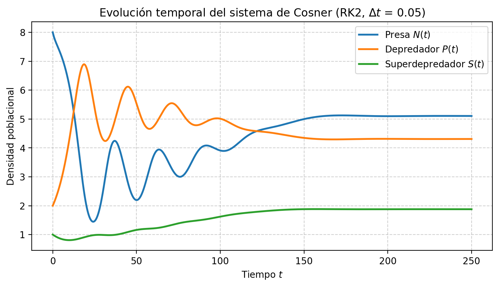
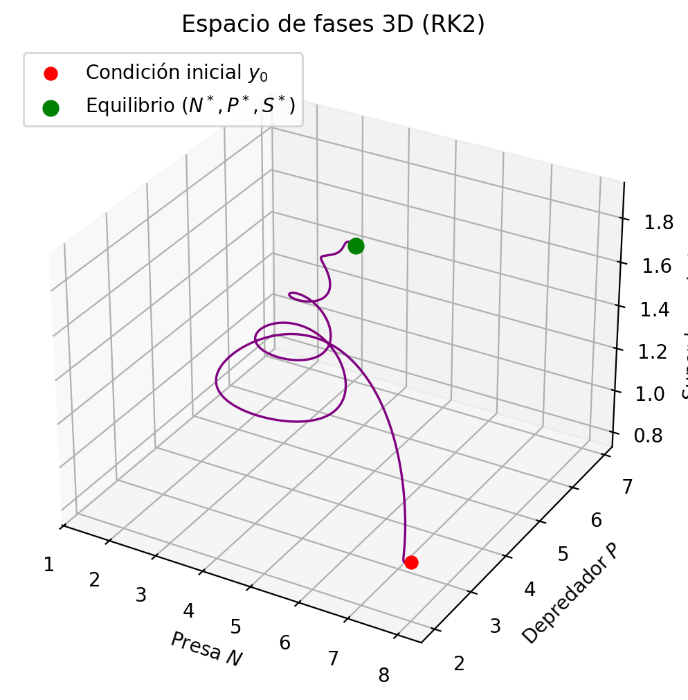
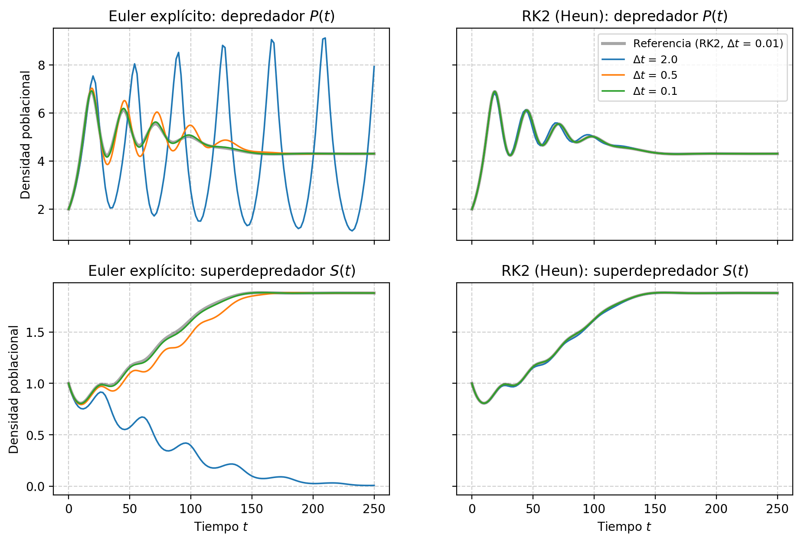
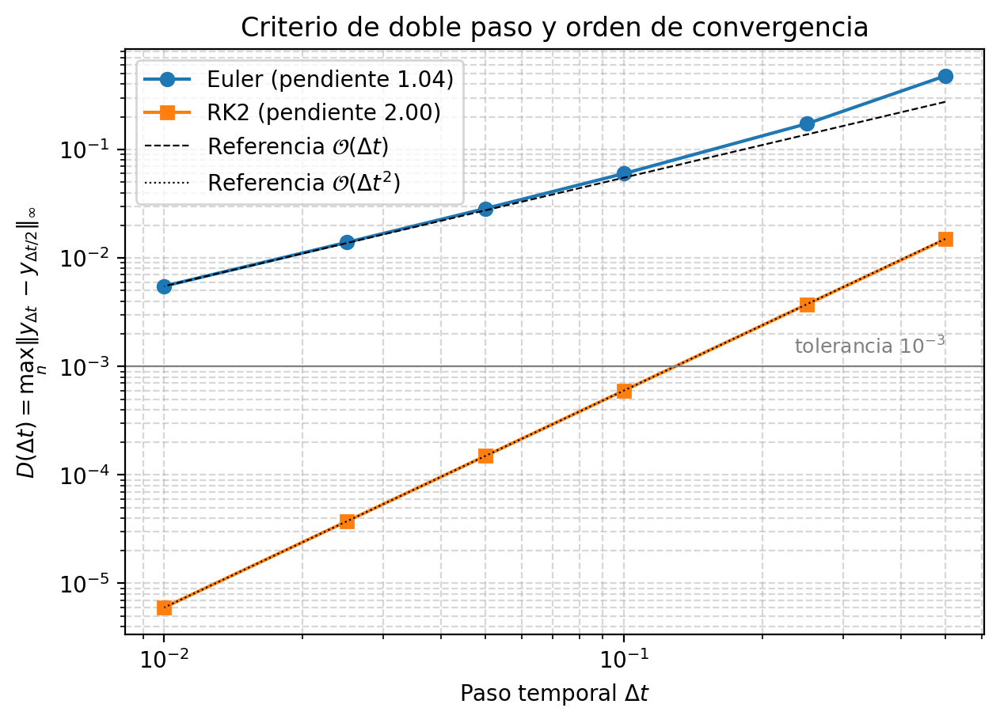
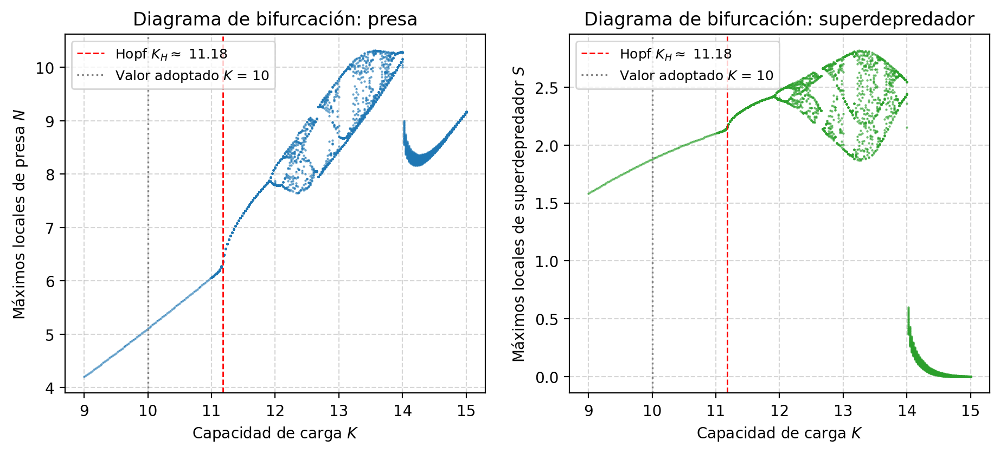
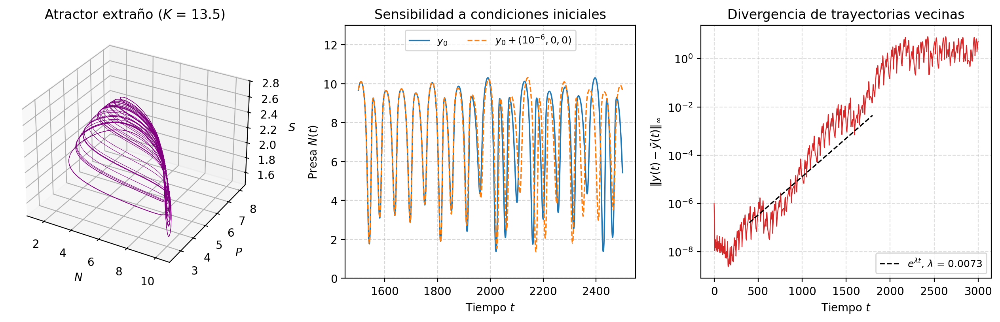

Las densidades y el tiempo se expresan en las escalas numéricas del modelo asignado; la consigna no especifica unidades físicas ni una transformación de adimensionalización.

## Resumen

En este trabajo se modela y analiza numéricamente la dinámica de un sistema ecológico tritrófico compuesto por una presa ($N$), un depredador intermedio ($P$) y un superdepredador omnívoro ($S$), gobernado por el modelo no lineal de Cosner con respuestas funcionales racionales cuadráticas. Para resolver el problema de valor inicial se implementaron los métodos de Euler explícito y Runge-Kutta de segundo orden (RK2/Heun). Se verificó empíricamente el orden de convergencia de ambos esquemas (1.04 y 2.00, respectivamente) y se justificó la elección del paso $\Delta t = 0.05$ mediante el criterio de doble paso, con una discrepancia máxima de $1.5\times10^{-4}$, inferior a la tolerancia de $10^{-3}$. Se mostró además que la parametrización inicial conducía a la extinción del depredador y del superdepredador. Por eso se calibró un conjunto de parámetros dentro de los rangos de la consigna que produce coexistencia asintóticamente estable en $(N^*, P^*, S^*) = (5.105,\ 4.308,\ 1.878)$. Un barrido de $K$ muestra un cruce de estabilidad local cerca de $K=11.18$ y comportamiento irregular; las estimaciones de Lyapunov se comparan con distintos pasos y ventanas.

## 1. Introducción

La dinámica de poblaciones ha sido tradicionalmente abordada mediante el sistema clásico de Lotka-Volterra. Si bien este modelo pionero capturó la naturaleza oscilatoria de las interacciones presa-depredador, adolece de severas simplificaciones ecológicas: asume crecimiento maltusiano irrestricto de la presa en ausencia de depredadores, considera una tasa de ataque lineal sin límite biológico (Holling Tipo I) y genera órbitas periódicas neutralmente estables, sumamente sensibles a perturbaciones del medio.

Para representar con mayor fidelidad los ecosistemas reales surgen modelos no lineales que incorporan la capacidad de carga del hábitat (crecimiento logístico) y respuestas funcionales saturables. En particular, el modelo asignado utiliza funciones de consumo de tipo racional cuadrático, que capturan la saturación por manipulación de presas y los efectos de defensa o confusión grupal a densidades elevadas.

El objetivo del trabajo es modelar un ecosistema de tres niveles tróficos bajo esta formulación, analizar su comportamiento asintótico mediante integración numérica discreta y comparar el desempeño de Euler frente a RK2. También se busca establecer un criterio riguroso para elegir el paso temporal $\Delta t$ y delimitar los parámetros que impiden la emergencia de dinámicas caóticas.

## 2. Formulación Matemática del Modelo

### 2.1. Sistema de ecuaciones diferenciales

El modelo describe la tasa de variación temporal de las densidades poblacionales mediante el siguiente sistema de EDOs acopladas:

$$
\begin{aligned}
\dfrac{dN}{dt} &= r N \left(1 - \dfrac{N}{K}\right) - d N - F_{PN}(N, P)\, P - F_{SN}(N, S)\, S \\
\dfrac{dP}{dt} &= b\, F_{PN}(N, P)\, P - m P - F_{SP}(P, S)\, S \\
\dfrac{dS}{dt} &= f\, F_{SN}(N, S)\, S + g\, F_{SP}(P, S)\, S - q S
\end{aligned}
$$

donde $N(t)$, $P(t)$ y $S(t)$ son las densidades poblacionales de la presa, del depredador intermedio y del superdepredador, respectivamente.

### 2.2. Respuestas funcionales racionales cuadráticas

Las tasas de consumo per cápita están dadas por funciones racionales cuadráticas:

$$
\begin{aligned}
F_{PN}(N, P) &= \dfrac{a N}{1 + b_1 N + c_1 N^2} \\
F_{SN}(N, S) &= \dfrac{c N}{1 + b_2 N + c_2 N^2} \\
F_{SP}(P, S) &= \dfrac{e P}{1 + b_3 P + c_3 P^2}
\end{aligned}
$$

* **Parámetros $a, c, e$:** tasas de ataque o búsqueda a bajas densidades.
* **Parámetros $b_1, b_2, b_3$:** coeficientes asociados al tiempo de manipulación (*handling time*), que saturan la ingesta a densidades intermedias.
* **Parámetros $c_1, c_2, c_3$:** coeficientes cuadráticos que modelan la inhibición o defensa gregaria a densidades altas (cardúmenes, manadas).

Con $c_i > 0$ la respuesta no es monótona: crece hasta un máximo y luego decrece. Derivando se obtiene

$$
\max_{x \ge 0} \frac{\alpha x}{1 + \beta x + \gamma x^2} = \frac{\alpha}{\beta + 2\sqrt{\gamma}}, \qquad \text{alcanzado en } x = \frac{1}{\sqrt{\gamma}},
$$

de modo que con $c_i = 0.01$ el consumo máximo ocurre a densidad $10$. Esta cota es la que determina si un consumidor puede o no persistir (Sección 2.4).

### 2.3. Parámetros del sistema

| Símbolo | Significado biológico | Rango de la consigna | Valor adoptado |
| :------: | :---------------------------------------------- | :-----------: | :-----------------: |
| $r$ | Tasa de natalidad de la presa | — | $1.0$ |
| $K$ | Capacidad de carga del ambiente | — | $10.0$ |
| $d$ | Tasa de mortalidad natural de la presa | — | $0.1$ |
| $b$ | Eficiencia de conversión ($N \to P$) | — | $0.5$ |
| $m$ | Tasa de mortalidad natural del depredador | — | $0.1$ |
| $f$ | Eficiencia de conversión ($N \to S$) | — | $0.2$ |
| $g$ | Eficiencia de conversión ($P \to S$) | — | $0.4$ |
| $q$ | Tasa de mortalidad del superdepredador | — | $0.12$ |
| $a, c, e$ | Tasas de ataque | $0.01 - 0.5$ | $0.15,\ 0.05,\ 0.10$ |
| $b_1, b_2, b_3$ | Coeficientes lineales de saturación | $0.1 - 2.0$ | $0.1,\ 0.5,\ 0.1$ |
| $c_1, c_2, c_3$ | Coeficientes cuadráticos de inhibición | $0 - 0.1$ | $0.01,\ 0.01,\ 0.01$ |

La condición inicial es $\mathbf{y}_0 = (N_0, P_0, S_0) = (8,\ 2,\ 1)$: la presa está cerca de su capacidad de carga y los consumidores están en baja densidad. Se integra en $t \in [0, 250]$.

### 2.4. Puntos de equilibrio y criterio de calibración

**Diagnóstico de la parametrización inicial.** El borrador original proponía $K = 100$, $m = 0.2$, $q = 0.1$ y $b_1 = b_3 = 0.5$. Con esos valores, la tasa máxima de crecimiento per cápita del depredador es

$$
b \cdot \max_N F_{PN} - m = 0.5 \cdot \frac{0.15}{0.5 + 2\sqrt{0.01}} - 0.2 = 0.107 - 0.2 < 0,
$$

por lo que $dP/dt < 0$ para todo $N$ y el depredador se extingue. Sin presas intermedias, el superdepredador tampoco se sostiene, pues $f \cdot \max_N F_{SN} - q = 0.014 - 0.1 < 0$. La integración numérica confirma que esa parametrización converge a $(N, P, S) \to (90, 0, 0)$, sin coexistencia.

**Calibración adoptada.** Se modificaron únicamente parámetros sin rango prescripto ($K$, $m$, $q$) y coeficientes de saturación dentro de su rango ($b_1$, $b_3$):

1. $b_1 = 0.1$ y $m = 0.1$: el depredador puede crecer, ya que $b \cdot \max F_{PN} = 0.5 \cdot 0.15/0.3 = 0.25 > m$.
2. $b_3 = 0.1$ y $q = 0.12$: el superdepredador puede sostenerse consumiendo depredadores, ya que $g \cdot \max F_{SP} = 0.4 \cdot 0.10/0.3 = 0.133 > q$.
3. $K = 10$: con capacidades de carga altas el equilibrio de coexistencia se vuelve inestable (*paradoja del enriquecimiento*, Rosenzweig 1971). La Sección 4.5 muestra que el umbral es $K_H \approx 11.18$.

**Equilibrios resultantes** (calculados por Newton-Raphson, con residuo $\|\mathbf{f}(\mathbf{y}^*)\|_\infty = 6\times10^{-16}$):

| Equilibrio | Coordenadas $(N, P, S)$ | Autovalores del Jacobiano | Tipo |
| :------------ | :-----------------: | :----------------------------: | :---------------- |
| Trivial | $(0, 0, 0)$ | $0.9,\ -0.1,\ -0.12$ | Silla (inestable) |
| Solo presa | $(9, 0, 0)$ | $-0.9,\ +0.149,\ -0.106$ | Silla: $P$ invade |
| Borde $N$–$P$ | $(1.577,\ 5.852,\ 0)$ | $-0.0137 \pm 0.247i,\ +0.0101$ | Silla: $S$ invade |
| **Coexistencia** | $(5.105,\ 4.308,\ 1.878)$ | $-0.1433,\ -0.0386 \pm 0.1033i$ | **Foco estable** |

Los tres equilibrios de borde estudiados son invadibles; esto no demuestra persistencia global. El equilibrio interior tiene un par de autovalores complejos con parte real negativa, lo que anticipa una convergencia en espiral. El período de la oscilación amortiguada es $2\pi / 0.1033 \approx 61$ y el tiempo característico de decaimiento es $1/0.0386 \approx 26$ unidades.

## 3. Metodología Numérica

Definiendo el vector de estado $\mathbf{y}(t) = [N(t), P(t), S(t)]^T$ y el campo vectorial $\mathbf{f}(t, \mathbf{y}) = [f_N, f_P, f_S]^T$, el problema se reduce al PVI:

$$
\frac{d\mathbf{y}}{dt} = \mathbf{f}(t, \mathbf{y}), \qquad \mathbf{y}(0) = \mathbf{y}_0
$$

Los integradores rechazan estados no finitos o negativos, incluso el predictor de Heun. No se aplica proyección; si ocurre un rechazo debe reducirse el paso y revisarse la simulación.

### 3.1. Método de Euler explícito (orden 1)

Discretizando el intervalo temporal con paso constante $\Delta t$:

$$
\mathbf{y}_{n+1} = \mathbf{y}_n + \Delta t \, \mathbf{f}(t_n, \mathbf{y}_n)
$$

* **Error de truncamiento local:** $\mathcal{O}(\Delta t^2)$.
* **Error global:** $\mathcal{O}(\Delta t)$.

### 3.2. Método de Runge-Kutta 2 (Heun, predictor-corrector, orden 2)

$$
\begin{aligned}
\mathbf{k}_1 &= \mathbf{f}(t_n, \mathbf{y}_n) \\
\mathbf{k}_2 &= \mathbf{f}(t_n + \Delta t,\ \mathbf{y}_n + \Delta t\, \mathbf{k}_1) \\
\mathbf{y}_{n+1} &= \mathbf{y}_n + \dfrac{\Delta t}{2} \left(\mathbf{k}_1 + \mathbf{k}_2\right)
\end{aligned}
$$

* **Error de truncamiento local:** $\mathcal{O}(\Delta t^3)$.
* **Error global:** $\mathcal{O}(\Delta t^2)$, con dos evaluaciones de $\mathbf{f}$ por paso.

**Un paso, una sola corrección.** En la implementación, cada paso temporal aplica el predictor una vez y el corrector una única vez. No se itera el corrector. En la variante iterativa del método de Heun (Chapra & Canale), el corrector se repite y recalcula la pendiente final con el valor ya corregido:

$$
\mathbf{y}_{n+1}^{(j+1)} = \mathbf{y}_n + \frac{\Delta t}{2}\left[\mathbf{f}(t_n, \mathbf{y}_n) + \mathbf{f}\big(t_{n+1}, \mathbf{y}_{n+1}^{(j)}\big)\right], \qquad j = 0, 1, 2, \dots
$$

Si $\frac{\Delta t}{2}\|J\| < 1$, esta iteración de punto fijo converge a la regla del trapecio implícita:

$$
\mathbf{y}_{n+1} = \mathbf{y}_n + \frac{\Delta t}{2}\left[\mathbf{f}(t_n, \mathbf{y}_n) + \mathbf{f}(t_{n+1}, \mathbf{y}_{n+1})\right]
$$

La regla del trapecio también tiene error global $\mathcal{O}(\Delta t^2)$. Iterar el corrector no aumenta el orden, pero cambia la aproximación, el costo y puede cambiar sus propiedades de estabilidad. Con una única corrección ($j = 0$) el esquema ya alcanza el orden 2 con dos evaluaciones por paso, y sigue siendo explícito. El orden observado de 2.00 de la Sección 4.4 es coherente con ello. Euler usa una evaluación por paso.

### 3.3. Estabilidad absoluta

Linealizando en torno a un equilibrio con la matriz Jacobiana $J = \partial \mathbf{f}/\partial \mathbf{y}$ y aplicando la ecuación test de Dahlquist $y' = \lambda y$, cada método multiplica el error por un factor de amplificación $R(z)$ con $z = \lambda \Delta t$. El paso es linealmente estable si $|R(\lambda_i \Delta t)| \le 1$ para todos los autovalores $\lambda_i(J)$:

$$
R_{\text{Euler}}(z) = 1 + z, \qquad R_{\text{RK2}}(z) = 1 + z + \frac{z^2}{2}
$$

Para un autovalor complejo $\lambda = \alpha + i\beta$ con $\alpha < 0$, Euler es estable si y solo si $\Delta t \le -2\alpha / |\lambda|^2$. Si $\alpha \approx 0$ (modos casi conservativos), el paso admisible tiende a cero. Esto es el análogo del oscilador armónico, donde Euler introduce un amortiguamiento negativo artificial y amplifica espuriamente la energía.

### 3.4. Criterio de doble paso (Runge / Richardson)

Se integra con $\Delta t$ y con $\Delta t/2$ y se mide la discrepancia en los instantes comunes:

$$
D(\Delta t) = \max_n \left\| \mathbf{y}_{\Delta t}(t_n) - \mathbf{y}_{\Delta t/2}(t_n) \right\|_\infty
$$

Para un método de orden $p$ se cumple $D(\Delta t) \approx C\,(1 - 2^{-p})\,\Delta t^p$. La pendiente de $\log D$ contra $\log \Delta t$ estima entonces el orden observado, y el paso se considera validado cuando $D(\Delta t) < 10^{-3}$.

### 3.5. Herramientas de análisis complementarias

* **Jacobiano:** diferencias centradas, $J_{:,j} \approx [\mathbf{f}(\mathbf{y} + h\mathbf{e}_j) - \mathbf{f}(\mathbf{y} - h\mathbf{e}_j)]/(2h)$ con $h = 10^{-6}$.
* **Equilibrios:** Newton-Raphson, $J(\mathbf{y}_k)\,\boldsymbol{\delta} = -\mathbf{f}(\mathbf{y}_k)$, a partir del estado final de la simulación.
* **Bifurcación de Hopf:** bisección sobre $K$ del valor $\max_i \operatorname{Re}\lambda_i(J(\mathbf{y}^*))$ hasta hallar su cruce por cero.
* **Exponente de Lyapunov máximo (Benettin):** se integran con RK2 dos trayectorias separadas $d_0 = 10^{-8}$, se acumula $\ln(d_k/d_0)$ cada $\tau = 2$ unidades de tiempo y se renormaliza la separación:

$$
\lambda_{\max} \approx \frac{1}{n\tau} \sum_{k=1}^{n} \ln\frac{d_k}{d_0}
$$

Un exponente positivo estimado indica separación exponencial local durante el período medido; valores próximos a cero o negativos no identifican por sí solos el régimen. Deben analizarse transitorios, paso y tiempo de promedio.

## 4. Resultados y Discusión

Todas las figuras y valores numéricos de esta sección se obtienen ejecutando `generar_figuras.py` (Anexo A.3), que reutiliza los integradores de `euler_cosner.py` y `rk2_cosner.py`.

### 4.1. Evolución temporal hacia el equilibrio



*__Figura 1.__ Evolución temporal de las tres poblaciones integradas con RK2 y $\Delta t = 0.05$.*

Tras un transitorio oscilatorio con período cercano a 60 unidades (coherente con $\operatorname{Im}\lambda = 0.1033$), las tres poblaciones convergen a la coexistencia $(N^*, P^*, S^*) = (5.105,\ 4.308,\ 1.878)$. En $t = 250$ la distancia al equilibrio es $\|\mathbf{y}(250) - \mathbf{y}^*\|_\infty = 2.9\times10^{-4}$. El superdepredador crece lentamente porque su tasa de invasión desde el borde $N$–$P$ es pequeña ($+0.0101$).

### 4.2. Trayectoria en el espacio de fases



*__Figura 2.__ Trayectoria en el espacio $(N, P, S)$: espiral convergente hacia el foco estable.*

La trayectoria describe una espiral que se cierra sobre el equilibrio interior. Esto es consistente con un foco estable: un par complejo conjugado con parte real negativa y un tercer autovalor real negativo, que atrae rápidamente la trayectoria hacia el plano de la espiral.

### 4.3. Sensibilidad frente a $\Delta t$: Euler vs. RK2



*__Figura 3.__ Depredador $P(t)$ y superdepredador $S(t)$ con $\Delta t \in \{2,\ 0.5,\ 0.1\}$ para cada método. La curva gris es la referencia, RK2 con $\Delta t = 0.01$.*

Con los autovalores de la Sección 2.4, el paso máximo linealmente estable en el equilibrio es $\Delta t_{\max} = 6.35$ para Euler (limitado por el par complejo) y $13.96$ para RK2 (limitado por el autovalor real). Aun así, la Figura 3 muestra diferencias marcadas entre ambos métodos:

* **Euler con $\Delta t = 0.5$** reproduce el equilibrio final, pero con errores visibles de amplitud y fase durante el transitorio.
* **Euler con $\Delta t = 2$** produce un resultado cualitativamente falso: las oscilaciones de $P$ crecen en lugar de amortiguarse y el superdepredador se extingue numéricamente. El paso $\Delta t = 2$ es linealmente estable en el equilibrio interior ($2 < 6.35$), pero en el borde $N$–$P$, por donde pasa el transitorio, los modos oscilatorios tienen $|1 + \lambda\Delta t| = 1.091 > 1$. Euler los amplifica un 9% por paso y la trayectoria discreta queda atrapada en una oscilación espuria. La estabilidad lineal en $\mathbf{y}^*$ es necesaria pero no suficiente; por eso hace falta además un criterio de precisión.
* **RK2** se mantiene prácticamente superpuesto a la referencia con los tres pasos, incluso con $\Delta t = 2$.

### 4.4. Selección y justificación del paso $\Delta t$

| $\Delta t$ | $D(\Delta t)$ Euler | $D(\Delta t)$ RK2 | Orden observado Euler | Orden observado RK2 |
| :---: | :---: | :---: | :---: | :---: |
| $0.5$ | $4.77\times10^{-1}$ | $1.49\times10^{-2}$ | $1.46$ | $1.99$ |
| $0.25$ | $1.73\times10^{-1}$ | $3.74\times10^{-3}$ | $1.16$ | $2.00$ |
| $0.1$ | $6.00\times10^{-2}$ | $5.99\times10^{-4}$ | $1.07$ | $2.00$ |
| $\mathbf{0.05}$ | $2.86\times10^{-2}$ | $\mathbf{1.50\times10^{-4}}$ | $1.03$ | $2.00$ |
| $0.025$ | $1.40\times10^{-2}$ | $3.75\times10^{-5}$ | $1.02$ | $2.00$ |
| $0.01$ | $5.50\times10^{-3}$ | $5.99\times10^{-6}$ | — | — |

La tolerancia $10^{-3}$ se aplica a la discrepancia $D$, no al error. En régimen asintótico, para orden $p$, las estimaciones son $E_h \approx D/(1-2^{-p})$ y $E_{h/2} \approx D/(2^p-1)$; no son errores exactos ni garantías rigurosas. Para Euler con $h=0.001$, $E_h \approx 1.0911\times 10^{-3}$; para RK2 con $h=0.05$, $E_h \approx 1.9975\times10^{-4}$.



*__Figura 4.__ Criterio de doble paso en escala log-log. Las pendientes ajustadas para $\Delta t \le 0.1$ son 1.04 (Euler) y 2.00 (RK2) y coinciden con los órdenes teóricos.*

* **Orden verificado:** al dividir $\Delta t$ por la mitad, la discrepancia de Euler se reduce a la mitad y la de RK2 a la cuarta parte, como predice la teoría.
* **La restricción efectiva es la precisión:** los pasos que cumplen la tolerancia son mucho menores que los límites de estabilidad lineal (6.35 y 13.96).
* **Paso adoptado:** RK2 satisface la tolerancia $10^{-3}$ desde $\Delta t = 0.1$. Se adopta $\Delta t = 0.05$, que deja un margen de casi 7 veces ($D = 1.5\times10^{-4}$) con 5000 pasos, es decir, $10^4$ evaluaciones de $\mathbf{f}$.
* **Costo comparado:** Para el criterio común $D<10^{-3}$, Euler con $h=0.001$ da $D=5.4532\times10^{-4}$ y requiere 250 000 evaluaciones para resolver; RK2 con $h=0.05$ da $D=1.4982\times10^{-4}$ y requiere 10 000. Validar requiere además resolver la malla refinada: 500 000 y 20 000 evaluaciones adicionales, respectivamente. Ambos cumplen la misma tolerancia, aunque sus discrepancias no son iguales. Euler con $h=0.0005$ da $D=2.7253\times10^{-4}$.

### 4.5. Zonas de inestabilidad: bifurcación de Hopf y caos

La parametrización elegida debe quedar lejos de la región caótica. Para delimitarla se varía la capacidad de carga $K$, que es el parámetro que controla el enriquecimiento del sistema, manteniendo fijos todos los demás.



*__Figura 5.__ Diagrama de bifurcación respecto de $K$: máximos locales de $N(t)$ y $S(t)$ tras descartar el transitorio ($t > 2000$). Un único máximo repetido puede corresponder a un ciclo simple; un equilibrio requiere amplitud tendiente a cero y residuo del campo pequeño. Varios máximos requieren estudiar su repetición y los transitorios; una nube sugiere irregularidad y requiere comprobaciones adicionales para hablar de caos.*

| $K$ | $\lambda_{\max}$ (Lyapunov) | Régimen |
| :---: | :---: | :--- |
| $10$ (adoptado) | $-0.0383$ | Equilibrio estable ($\approx \operatorname{Re}\lambda_{2,3} = -0.0386$) |
| $11.5$ | $+0.0001$ | Ciclo límite (período 1) |
| $12$ | $-0.0001$ | Ciclo límite (período 2) |
| $12.25$ | $+0.0059$ | Irregularidad observada |
| $13.5$ | $+0.0073$ | Comportamiento irregular; estimación de tiempo finito |

El cruce de un par de autovalores cerca de $K=11.18$ aporta evidencia de una bifurcación de Hopf; no demuestra por sí solo que aparezca un ciclo estable. Los máximos sugieren cambios de régimen, pero deben comprobarse la duración del transitorio y la repetición. La nomenclatura período $p$ indica $p$ máximos distintos que se repiten en una órbita; no se infiere un equilibrio a partir de un único máximo.



*__Figura 6.__ Comportamiento observado para $K=13.5$ y sensibilidad a condiciones iniciales. Las trayectorias a tiempos largos no deben compararse punto a punto para validar un régimen caótico. La pendiente indicada es una estimación de tiempo finito, sensible al paso y a la ventana de integración.*

Para $K=13.5$ se recalculó el exponente máximo mediante dos trayectorias renormalizadas. Con transitorio 2000 y promedio 4000, para $h=0.05$, $0.025$ y $0.0125$ se obtienen respectivamente 0.00731, 0.00819 y 0.00799; con transitorio 4000 y promedio 8000 se obtienen 0.00833, 0.00831 y 0.00938. El signo positivo persiste, pero la variación muestra que las cifras no están convergidas a cuatro decimales. Son estimaciones de tiempo finito, no una prueba rigurosa de caos.

Para el conjunto adoptado $K=10$, el equilibrio interior es localmente estable y la trayectoria estudiada se aproxima a él. No se deduce de ello estabilidad global ni estabilidad para todo $K<K_H$. El teorema de Poincaré–Bendixson se aplica a EDO autónomas planas bajo sus hipótesis, no a cualquier sistema bidimensional.

## 5. Conclusiones

* Se implementaron los métodos de Euler explícito y RK2 (Heun) en códigos modulares para el modelo tritrófico, y se verificaron empíricamente sus órdenes de convergencia: 1.04 y 2.00.
* El paso $\Delta t = 0.05$ con RK2 queda justificado por el criterio de doble paso ($D = 1.5\times10^{-4} < 10^{-3}$). Para $D<10^{-3}$, los pasos probados de Euler y RK2 requieren respectivamente 250 000 y 10 000 evaluaciones para resolver; la validación agrega las mallas refinadas. Con pasos grandes ($\Delta t = 2$), Euler produce dinámicas espurias, como la extinción numérica del superdepredador, aunque el paso sea linealmente estable en el equilibrio.
* La parametrización original no permitía la coexistencia porque la tasa máxima de consumo del depredador no compensaba su mortalidad. Se calibró un conjunto de parámetros dentro de los rangos de la consigna que garantiza un equilibrio de coexistencia asintóticamente estable, con todos los equilibrios de borde invadibles.
* El barrido de $K$ sugiere cambios de estabilidad y comportamiento irregular; su clasificación asintótica requiere estudios adicionales de transitorios y refinamiento. Para $K=10$ se verifica estabilidad local del equilibrio estudiado.
* El término cuadrático $c_i x^2$ de la respuesta funcional acota el consumo máximo en $\alpha/(\beta + 2\sqrt{\gamma})$. Este valor resulta ser la magnitud clave para decidir si cada nivel trófico puede persistir.

## 6. Referencias

1. Cátedra de Cálculo Numérico, Universidad Austral. *Problema 10*: consigna del modelo asignado.
2. Cosner, C., DeAngelis, D. L., Ault, J. S., & Olson, D. B. (1999). Effects of spatial grouping on the functional response of predators. *Theoretical Population Biology*, 56(1), 65–75.
2. Burden, R. L., & Faires, J. D. (2010). *Numerical Analysis* (9th ed.). Brooks/Cole.
3. Strogatz, S. H. (2018). *Nonlinear Dynamics and Chaos: With Applications to Physics, Biology, Chemistry, and Engineering* (2nd ed.). CRC Press.
4. Hastings, A., & Powell, T. (1991). Chaos in a three-species food chain. *Ecology*, 72(3), 896–903.
5. Rosenzweig, M. L. (1971). Paradox of enrichment: destabilization of exploitation ecosystems in ecological time. *Science*, 171(3969), 385–387.
6. Benettin, G., Galgani, L., Giorgilli, A., & Strelcyn, J.-M. (1980). Lyapunov characteristic exponents for smooth dynamical systems and for Hamiltonian systems; a method for computing all of them. *Meccanica*, 15, 9–30.
7. Chapra, S. C., & Canale, R. P. (2015). *Numerical Methods for Engineers* (7th ed.). McGraw-Hill Education.

## Anexo A: Código Fuente

| Archivo | Función | Sección del informe |
| :--- | :--- | :---: |
| `euler_cosner.py`, `rk2_cosner.py` | `F_PN`, `F_SN`, `F_SP` | 2.2 |
| `euler_cosner.py`, `rk2_cosner.py` | `sistema_cosner` | 2.1 |
| `euler_cosner.py` | `resolver_euler` | 3.1 |
| `rk2_cosner.py` | `resolver_rk2` | 3.2 |
| `generar_figuras.py` | `PARAMETROS`, `ESTADO_INICIAL` | 2.3 |
| `generar_figuras.py` | `jacobiano`, `equilibrio_newton` | 2.4, 3.5 |
| `generar_figuras.py` | `paso_maximo_estable` | 3.3, 4.3 |
| `generar_figuras.py` | `diferencia_doble_paso` | 3.4, 4.3 |
| `generar_figuras.py` | `K_critico_hopf`, `exponente_lyapunov` | 3.5, 4.5 |
| `generar_figuras.py` | `figura_1_...` a `figura_6_...` | 4.1 – 4.5 |

Ejecución: `python docs/generar_figuras.py` (requiere `numpy` y `matplotlib`; las imágenes se guardan en `docs/figuras/`).

<!-- ANEXO:INICIO (sección generada por construir_informe.py a partir de los .py; no editar a mano) -->

### A.1. `euler_cosner.py`: Método de Euler explícito

```python
"""
===============================================================================
Trabajo Práctico: Cálculo Numérico - Modelo Tritrófico de Cosner
Archivo: euler_cosner.py
Método: Euler Progresivo (Primer Orden)
===============================================================================
Descripción:
    Este script implementa la simulación numérica del modelo presa-depredador-
    superdepredador propuesto por Cosner con respuesta funcional racional cuadrática,
    utilizando el método de integración temporal de Euler Explícito.
    
    El código evalúa la convergencia y estabilidad frente a la variación del paso dt
    y grafica la evolución temporal de las densidades poblacionales N(t), P(t), S(t).
===============================================================================
"""

import numpy as np
import matplotlib.pyplot as plt


# =============================================================================
# 1. DEFINICIÓN DE RESPUESTAS FUNCIONALES DE COSNER
#    (Corresponde a la Sección 2.2 del Informe)
# =============================================================================

def F_PN(N, a, b1, c1):
    """
    Tasa de consumo per cápita de la presa (N) por parte del depredador (P).
    Respuesta funcional racional cuadrática generalizada.
    """
    return (a * N) / (1.0 + b1 * N + c1 * (N ** 2))


def F_SN(N, c, b2, c2):
    """
    Tasa de consumo per cápita de la presa (N) por parte del superdepredador (S).
    """
    return (c * N) / (1.0 + b2 * N + c2 * (N ** 2))


def F_SP(P, e, b3, c3):
    """
    Tasa de consumo per cápita del depredador (P) por parte del superdepredador (S).
    """
    return (e * P) / (1.0 + b3 * P + c3 * (P ** 2))


# =============================================================================
# 2. SISTEMA DE ECUACIONES DIFERENCIALES ORDINARIAS (EDOs)
#    (Corresponde a la Sección 2.1 del Informe)
# =============================================================================

def sistema_cosner(t, estado, params):
    """
    Calcula las derivadas temporales dN/dt, dP/dt, dS/dt según el modelo de Cosner.
    
    Parámetros:
        t: Tiempo actual (float).
        estado: Vector de estado [N, P, S] con densidades poblacionales.
        params: Diccionario con todos los coeficientes biológicos del modelo.
    
    Retorna:
        np.array con [dN_dt, dP_dt, dS_dt].
    """
    N, P, S = estado
    
    # Extraer parámetros ecológicos
    r = params['r']      # Tasa de natalidad intrínseca de la presa
    K = params['K']      # Capacidad de carga del medio para la presa
    d = params['d']      # Tasa de mortalidad natural de la presa
    b = params['b']      # Eficiencia de conversión de presa en depredador
    m = params['m']      # Tasa de mortalidad natural del depredador
    f = params['f']      # Eficiencia de conversión de presa en superdepredador
    g = params['g']      # Eficiencia de conversión de depredador en superdepredador
    q = params['q']      # Tasa de mortalidad natural del superdepredador
    
    # Evaluar tasas de ataque no lineales
    fpn = F_PN(N, params['a'], params['b1'], params['c1'])
    fsn = F_SN(N, params['c_ataque'], params['b2'], params['c2'])
    fsp = F_SP(P, params['e'], params['b3'], params['c3'])
    
    # Ecuaciones de variación poblacional
    dN_dt = r * N * (1.0 - N / K) - d * N - fpn * P - fsn * S
    dP_dt = b * fpn * P - m * P - fsp * S
    dS_dt = f * fsn * S + g * fsp * S - q * S
    
    return np.array([dN_dt, dP_dt, dS_dt])


# =============================================================================
# 3. ALGORITMO NUMÉRICO: MÉTODO DE EULER EXPLÍCITO
#    (Corresponde a la Sección 3.1 del Informe)
# =============================================================================

def resolver_euler(f_sistema, y0, t0, t_max, dt, params):
    """
    Avanza la solución paso a paso mediante el esquema de Euler explícito:
        y_{n+1} = y_n + dt * f(t_n, y_n)
    
    Retorna:
        tiempos: Vector con la discretización temporal.
        solucion: Matriz de dimensiones (pasos, 3) con [N(t), P(t), S(t)].
    """
    y0 = np.asarray(y0, dtype=float)
    if (not np.isfinite(dt) or dt <= 0 or not np.isfinite(t0)
            or not np.isfinite(t_max) or t_max < t0):
        raise ValueError("Paso o intervalo temporal inválido")
    if y0.shape != (3,) or not np.all(np.isfinite(y0)) or np.any(y0 < 0):
        raise ValueError("El estado inicial debe tener tres poblaciones finitas no negativas")
    pasos = int(np.ceil((t_max - t0) / dt))
    tiempos = np.minimum(t0 + np.arange(pasos + 1) * dt, t_max)
    tiempos[-1] = t_max
    solucion = np.empty((pasos + 1, 3))
    solucion[0] = y0
    for n in range(pasos):
        tn, yn = tiempos[n], solucion[n]
        paso = tiempos[n + 1] - tn
        siguiente = yn + paso * f_sistema(tn, yn, params)
        if not np.all(np.isfinite(siguiente)) or np.any(siguiente < 0):
            raise ValueError("Población no finita o negativa; reduzca el paso")
        solucion[n + 1] = siguiente

    return tiempos, solucion


# =============================================================================
# 4. CONFIGURACIÓN EXPERIMENTAL Y PARÁMETROS BIOLÓGICOS
#    (Garantizan estabilidad asintótica y evitan zonas de caos)
# =============================================================================

if __name__ == '__main__':
    parametros = {
        'r': 1.0,           # Natalidad de la presa
        'K': 10.0,          # Capacidad de carga (K alto -> paradoja del enriquecimiento)
        'd': 0.1,           # Mortalidad de la presa
        'b': 0.5,           # Eficiencia conversión presa -> depredador
        'm': 0.1,           # Mortalidad depredador
        'f': 0.2,           # Eficiencia conversión presa -> superdepredador
        'g': 0.4,           # Eficiencia conversión depredador -> superdepredador
        'q': 0.12,          # Mortalidad superdepredador
        'a': 0.15,          # Tasa de ataque depredador -> presa (0.01 - 0.5)
        'c_ataque': 0.05,   # Tasa de ataque superdepredador -> presa (0.01 - 0.5)
        'e': 0.10,          # Tasa de ataque superdepredador -> depredador (0.01 - 0.5)
        'b1': 0.1,          # Coeficiente lineal N en F_PN (0.1 - 2.0)
        'b2': 0.5,          # Coeficiente lineal N en F_SN (0.1 - 2.0)
        'b3': 0.1,          # Coeficiente lineal P en F_SP (0.1 - 2.0)
        'c1': 0.01,         # Coeficiente cuadrático N^2 en F_PN (0.0 - 0.1)
        'c2': 0.01,         # Coeficiente cuadrático N^2 en F_SN (0.0 - 0.1)
        'c3': 0.01          # Coeficiente cuadrático P^2 en F_SP (0.0 - 0.1)
    }

    # Condiciones iniciales: presa cerca de su capacidad de carga, pocos depredadores
    estado_inicial = np.array([8.0, 2.0, 1.0])  # [N0, P0, S0]
    t_inicio = 0.0
    t_final = 250.0   # Tiempo suficiente para verificar estado asintótico

    # Justificación de dt: Comparación de estabilidad
    pasos_dt = [0.5, 0.1, 0.01]
    
    plt.figure(figsize=(12, 7))
    
    for dt in pasos_dt:
        t_vec, sol = resolver_euler(sistema_cosner, estado_inicial, t_inicio, t_final, dt, parametros)
        plt.plot(t_vec, sol[:, 0], label=f'Presa N(t) [dt={dt}]', alpha=0.8)
    
    plt.title('Sensibilidad del Método de Euler frente al Paso dt en el Modelo de Cosner', fontsize=13)
    plt.xlabel('Tiempo t', fontsize=11)
    plt.ylabel('Densidad de Población', fontsize=11)
    plt.grid(True, linestyle='--', alpha=0.6)
    plt.legend()
    plt.tight_layout()
    plt.savefig('comparacion_euler_dt.png', dpi=300)
    plt.close()
    print("Simulación con Euler completada. Gráfico guardado en 'comparacion_euler_dt.png'.")
```

### A.2. `rk2_cosner.py`: Método de Runge-Kutta 2 (Heun)

```python
"""
===============================================================================
Trabajo Práctico: Cálculo Numérico - Modelo Tritrófico de Cosner
Archivo: rk2_cosner.py
Método: Runge-Kutta 2 (Heun / Predictor-Corrector, Segundo Orden)
===============================================================================
Descripción:
    Este script implementa la simulación numérica del modelo presa-depredador-
    superdepredador de Cosner mediante el algoritmo de Runge-Kutta de orden 2 (RK2).
    
    Genera gráficos de la evolución temporal hacia el equilibrio asintótico,
    el espacio de fases tridimensional (N, P, S) y la verificación del doble paso
    para la justificación formal del dt.
===============================================================================
"""

import numpy as np
import matplotlib.pyplot as plt


# =============================================================================
# 1. DEFINICIÓN DE RESPUESTAS FUNCIONALES DE COSNER
#    (Corresponde a la Sección 2.2 del Informe)
# =============================================================================

def F_PN(N, a, b1, c1):
    """
    Tasa de consumo per cápita de la presa (N) por parte del depredador (P).
    F_PN = (a * N) / (1 + b1 * N + c1 * N^2)
    """
    return (a * N) / (1.0 + b1 * N + c1 * (N ** 2))


def F_SN(N, c, b2, c2):
    """
    Tasa de consumo per cápita de la presa (N) por parte del superdepredador (S).
    F_SN = (c * N) / (1 + b2 * N + c2 * N^2)
    """
    return (c * N) / (1.0 + b2 * N + c2 * (N ** 2))


def F_SP(P, e, b3, c3):
    """
    Tasa de consumo per cápita del depredador (P) por parte del superdepredador (S).
    F_SP = (e * P) / (1 + b3 * P + c3 * P^2)
    """
    return (e * P) / (1.0 + b3 * P + c3 * (P ** 2))


# =============================================================================
# 2. SISTEMA DE ECUACIONES DIFERENCIALES ORDINARIAS (EDOs)
#    (Corresponde a la Sección 2.1 del Informe)
# =============================================================================

def sistema_cosner(t, estado, params):
    """
    Evalúa el campo vectorial f(t, y) para el modelo tritrófico de Cosner.
    """
    N, P, S = estado
    
    r = params['r']
    K = params['K']
    d = params['d']
    b = params['b']
    m = params['m']
    f = params['f']
    g = params['g']
    q = params['q']
    
    fpn = F_PN(N, params['a'], params['b1'], params['c1'])
    fsn = F_SN(N, params['c_ataque'], params['b2'], params['c2'])
    fsp = F_SP(P, params['e'], params['b3'], params['c3'])
    
    dN_dt = r * N * (1.0 - N / K) - d * N - fpn * P - fsn * S
    dP_dt = b * fpn * P - m * P - fsp * S
    dS_dt = f * fsn * S + g * fsp * S - q * S
    
    return np.array([dN_dt, dP_dt, dS_dt])


# =============================================================================
# 3. ALGORITMO NUMÉRICO: RUNGE-KUTTA 2 (HEUN / SEGUNDO ORDEN)
#    (Corresponde a la Sección 3.2 del Informe)
# =============================================================================

def resolver_rk2(f_sistema, y0, t0, t_max, dt, params):
    """
    Avanza la solución mediante el esquema Runge-Kutta 2 (Heun):
        k1 = f(t_n, y_n)
        k2 = f(t_n + dt, y_n + dt * k1)
        y_{n+1} = y_n + (dt / 2) * (k1 + k2)
    
    Error de truncamiento local: O(dt^3)
    Error global acumulado: O(dt^2)

    Un paso = una sola corrección (el corrector no se itera): iterarlo converge
    a la regla del trapecio implícita, también de orden 2, pero con distintas
    propiedades de estabilidad y costo. Costo: 2 evaluaciones de f por paso.
    """
    y0 = np.asarray(y0, dtype=float)
    if (not np.isfinite(dt) or dt <= 0 or not np.isfinite(t0)
            or not np.isfinite(t_max) or t_max < t0):
        raise ValueError("Paso o intervalo temporal inválido")
    if y0.shape != (3,) or not np.all(np.isfinite(y0)) or np.any(y0 < 0):
        raise ValueError("El estado inicial debe tener tres poblaciones finitas no negativas")
    pasos = int(np.ceil((t_max - t0) / dt))
    tiempos = np.minimum(t0 + np.arange(pasos + 1) * dt, t_max)
    tiempos[-1] = t_max
    solucion = np.empty((pasos + 1, 3))
    solucion[0] = y0
    for n in range(pasos):
        tn, yn = tiempos[n], solucion[n]
        paso = tiempos[n + 1] - tn
        k1 = f_sistema(tn, yn, params)
        predictor = yn + paso * k1
        if not np.all(np.isfinite(predictor)) or np.any(predictor < 0):
            raise ValueError("Predictor no finito o negativo; reduzca el paso")
        k2 = f_sistema(tn + paso, predictor, params)
        siguiente = yn + paso / 2 * (k1 + k2)
        if not np.all(np.isfinite(siguiente)) or np.any(siguiente < 0):
            raise ValueError("Población no finita o negativa; reduzca el paso")
        solucion[n + 1] = siguiente

    return tiempos, solucion


# =============================================================================
# 4. CONFIGURACIÓN EXPERIMENTAL Y VISUALIZACIÓN
# =============================================================================

if __name__ == '__main__':
    parametros = {
        'r': 1.0,           # Natalidad de la presa
        'K': 10.0,          # Capacidad de carga presa
        'd': 0.1,           # Mortalidad de la presa
        'b': 0.5,           # Conversión presa -> depredador
        'm': 0.1,           # Mortalidad depredador
        'f': 0.2,           # Conversión presa -> superdepredador
        'g': 0.4,           # Conversión depredador -> superdepredador
        'q': 0.12,          # Mortalidad superdepredador
        'a': 0.15,          # Tasa de ataque F_PN
        'c_ataque': 0.05,   # Tasa de ataque F_SN
        'e': 0.10,          # Tasa de ataque F_SP
        'b1': 0.1,          # Coeficiente lineal N
        'b2': 0.5,          # Coeficiente lineal N
        'b3': 0.1,          # Coeficiente lineal P
        'c1': 0.01,         # Coeficiente cuadrático N^2
        'c2': 0.01,         # Coeficiente cuadrático N^2
        'c3': 0.01          # Coeficiente cuadrático P^2
    }

    estado_inicial = np.array([8.0, 2.0, 1.0])
    t_inicio = 0.0
    t_final = 250.0
    dt_elegido = 0.05   # Paso validado por doble paso (precisión y bajo costo)

    # 1. Integración con RK2
    t_vec, sol_rk2 = resolver_rk2(sistema_cosner, estado_inicial, t_inicio, t_final, dt_elegido, parametros)

    # 2. Gráfico 1: Evolución Temporal hacia el Equilibrio Asintótico
    plt.figure(figsize=(10, 5))
    plt.plot(t_vec, sol_rk2[:, 0], label='Presa N(t)', color='tab:blue', lw=2)
    plt.plot(t_vec, sol_rk2[:, 1], label='Depredador P(t)', color='tab:orange', lw=2)
    plt.plot(t_vec, sol_rk2[:, 2], label='Superdepredador S(t)', color='tab:green', lw=2)
    plt.title('Evolución Temporal del Sistema de Cosner (RK2, dt=0.05) - Estado Asintótico', fontsize=12)
    plt.xlabel('Tiempo t', fontsize=11)
    plt.ylabel('Densidad Poblacional', fontsize=11)
    plt.grid(True, linestyle='--', alpha=0.6)
    plt.legend()
    plt.tight_layout()
    plt.savefig('evolucion_asintotica_rk2.png', dpi=300)
    plt.close()

    # 3. Gráfico 2: Diagrama de Fases 3D (Espacio N-P-S)
    fig = plt.figure(figsize=(9, 7))
    ax = fig.add_subplot(111, projection='3d')
    ax.plot(sol_rk2[:, 0], sol_rk2[:, 1], sol_rk2[:, 2], color='purple', lw=1.5)
    ax.scatter([estado_inicial[0]], [estado_inicial[1]], [estado_inicial[2]], color='red', s=50, label='Condición Inicial y0')
    ax.scatter([sol_rk2[-1, 0]], [sol_rk2[-1, 1]], [sol_rk2[-1, 2]], color='green', s=60, label='Punto Fijo Asintótico')
    ax.set_title('Espacio de Fases 3D: Trayectoria Espiralada hacia Atractor de Punto Fijo', fontsize=12)
    ax.set_xlabel('Presa N')
    ax.set_ylabel('Depredador P')
    ax.set_zlabel('Superdepredador S')
    ax.legend()
    plt.tight_layout()
    plt.savefig('fases_3d_rk2.png', dpi=300)
    plt.close()

    print("Simulación con RK2 completada. Gráficos 'evolucion_asintotica_rk2.png' y 'fases_3d_rk2.png' generados con éxito.")
```

### A.3. `generar_figuras.py`: Análisis, figuras y tablas del informe

```python
"""
===============================================================================
Trabajo Práctico: Cálculo Numérico - Modelo Tritrófico de Cosner
Archivo: generar_figuras.py
Propósito: Generar todas las figuras y tablas numéricas del informe
===============================================================================
Descripción:
    Reutiliza el campo vectorial y los integradores implementados en
    euler_cosner.py y rk2_cosner.py (no reimplementa ningún método) y produce:

        Figura 1: Evolución temporal N(t), P(t), S(t) con RK2 (dt elegido).
        Figura 2: Espacio de fases 3D (N, P, S).
        Figura 3: Sensibilidad al paso dt: Euler vs. RK2.
        Figura 4: Orden de convergencia observado (criterio de doble paso).
        Figura 5: Diagrama de bifurcación respecto de la capacidad de carga K.
        Figura 6: Régimen caótico: atractor extraño y sensibilidad a y0.

    Además imprime en consola el punto de equilibrio, los autovalores del
    Jacobiano, los pasos máximos estables, la bifurcación de Hopf, los
    exponentes de Lyapunov y la tabla del criterio de doble paso del informe.

Ejecución:
    python docs/generar_figuras.py      (las imágenes se guardan en docs/figuras/)
===============================================================================
"""

import os

import numpy as np
import matplotlib
matplotlib.use('Agg')
import matplotlib.pyplot as plt

from euler_cosner import resolver_euler
from rk2_cosner import sistema_cosner, resolver_rk2


# =============================================================================
# 1. CONFIGURACIÓN (Tabla de la Sección 2.3 del Informe)
# =============================================================================

PARAMETROS = {
    'r': 1.0,           # Natalidad de la presa
    'K': 10.0,          # Capacidad de carga
    'd': 0.1,           # Mortalidad de la presa
    'b': 0.5,           # Eficiencia conversión presa -> depredador
    'm': 0.1,           # Mortalidad depredador
    'f': 0.2,           # Eficiencia conversión presa -> superdepredador
    'g': 0.4,           # Eficiencia conversión depredador -> superdepredador
    'q': 0.12,          # Mortalidad superdepredador
    'a': 0.15,          # Tasa de ataque F_PN (0.01 - 0.5)
    'c_ataque': 0.05,   # Tasa de ataque F_SN (0.01 - 0.5)
    'e': 0.10,          # Tasa de ataque F_SP (0.01 - 0.5)
    'b1': 0.1,          # Coeficiente lineal N en F_PN (0.1 - 2.0)
    'b2': 0.5,          # Coeficiente lineal N en F_SN (0.1 - 2.0)
    'b3': 0.1,          # Coeficiente lineal P en F_SP (0.1 - 2.0)
    'c1': 0.01,         # Coeficiente cuadrático N^2 en F_PN (0.0 - 0.1)
    'c2': 0.01,         # Coeficiente cuadrático N^2 en F_SN (0.0 - 0.1)
    'c3': 0.01          # Coeficiente cuadrático P^2 en F_SP (0.0 - 0.1)
}

ESTADO_INICIAL = np.array([8.0, 2.0, 1.0])   # [N0, P0, S0]
T_INICIO = 0.0
T_FINAL = 250.0
DT_ELEGIDO = 0.05

CARPETA_FIGURAS = os.path.join(os.path.dirname(os.path.abspath(__file__)), 'figuras')
COLORES = {'N': 'tab:blue', 'P': 'tab:orange', 'S': 'tab:green'}


# =============================================================================
# 2. HERRAMIENTAS DE ANÁLISIS (Secciones 3.3 y 4 del Informe)
# =============================================================================

def jacobiano(y, params, h=1e-6):
    """
    Aproxima la matriz Jacobiana J = df/dy por diferencias centradas:
        J[:, j] = (f(y + h e_j) - f(y - h e_j)) / (2h)
    """
    J = np.zeros((3, 3))
    for j in range(3):
        e_j = np.zeros(3)
        e_j[j] = h
        J[:, j] = (sistema_cosner(0.0, y + e_j, params) - sistema_cosner(0.0, y - e_j, params)) / (2.0 * h)
    return J


def equilibrio_newton(y_semilla, params, tol=1e-12, max_iter=50):
    """
    Refina un punto de equilibrio f(y*) = 0 con el método de Newton-Raphson:
        J(y_k) * delta = -f(y_k),   y_{k+1} = y_k + delta
    """
    y = np.array(y_semilla, dtype=float)
    for _ in range(max_iter):
        delta = np.linalg.solve(jacobiano(y, params), -sistema_cosner(0.0, y, params))
        y = y + delta
        if np.max(np.abs(delta)) < tol:
            break
    return y


def paso_maximo_estable(autovalores, factor_amplificacion, dt_max=50.0, n=500001):
    """
    Mayor dt tal que |R(lambda * dt)| <= 1 para todos los autovalores (ecuación test
    de Dahlquist). R(z) = 1 + z para Euler y R(z) = 1 + z + z^2/2 para RK2.
    """
    pasos = np.linspace(0.0, dt_max, n)[1:]
    inestable = np.zeros_like(pasos, dtype=bool)
    for lam in autovalores:
        inestable |= np.abs(factor_amplificacion(lam * pasos)) > 1.0
    return pasos[np.argmax(inestable)] if inestable.any() else np.inf


def max_parte_real(params, y_semilla):
    y = equilibrio_newton(y_semilla, params)
    return np.max(np.linalg.eigvals(jacobiano(y, params)).real)


def K_critico_hopf(params, K_estable, K_inestable, y_semilla, tol=1e-4):
    """
    Bisección sobre K del máximo Re(lambda) en el equilibrio interior:
    el valor donde cruza el cero es la bifurcación de Hopf.
    """
    while K_inestable - K_estable > tol:
        K_medio = 0.5 * (K_estable + K_inestable)
        if max_parte_real(dict(params, K=K_medio), y_semilla) < 0.0:
            K_estable = K_medio
        else:
            K_inestable = K_medio
    return 0.5 * (K_estable + K_inestable)


def diferencia_doble_paso(resolver, dt, params, y0=ESTADO_INICIAL, t_max=T_FINAL):
    """
    Criterio de doble paso (Runge / Richardson):
        D(dt) = max_n || y_dt(t_n) - y_{dt/2}(t_n) ||_inf
    Se compara únicamente en los instantes comunes a ambas mallas.
    """
    t_grueso, y_grueso = resolver(sistema_cosner, y0, T_INICIO, t_max, dt, params)
    t_fino, y_fino = resolver(sistema_cosner, y0, T_INICIO, t_max, dt / 2.0, params)
    indices = np.searchsorted(t_fino, t_grueso)
    indices = np.minimum(indices, len(t_fino) - 1)
    previos = np.maximum(indices - 1, 0)
    indices = np.where(abs(t_fino[previos] - t_grueso) < abs(t_fino[indices] - t_grueso), previos, indices)
    validos = np.isclose(t_grueso, t_fino[indices], rtol=1e-12, atol=1e-12)
    return np.max(np.abs(y_grueso[validos] - y_fino[indices[validos]]))


def guardar(fig, nombre):
    os.makedirs(CARPETA_FIGURAS, exist_ok=True)
    ruta = os.path.join(CARPETA_FIGURAS, nombre)
    fig.savefig(ruta, dpi=200, bbox_inches='tight')
    plt.close(fig)
    print(f"  -> {ruta}")


# =============================================================================
# 3. FIGURAS DEL INFORME (Sección 4)
# =============================================================================

def figura_1_evolucion(t, sol):
    fig, ax = plt.subplots(figsize=(9, 4.5))
    ax.plot(t, sol[:, 0], label='Presa $N(t)$', color=COLORES['N'], lw=2)
    ax.plot(t, sol[:, 1], label='Depredador $P(t)$', color=COLORES['P'], lw=2)
    ax.plot(t, sol[:, 2], label='Superdepredador $S(t)$', color=COLORES['S'], lw=2)
    ax.set_xlabel('Tiempo $t$')
    ax.set_ylabel('Densidad poblacional')
    ax.set_title(f'Evolución temporal del sistema de Cosner (RK2, $\\Delta t$ = {DT_ELEGIDO})')
    ax.grid(True, linestyle='--', alpha=0.6)
    ax.legend()
    guardar(fig, 'fig1_evolucion_temporal.png')


def figura_2_fases_3d(sol):
    fig = plt.figure(figsize=(7.5, 6))
    ax = fig.add_subplot(111, projection='3d')
    ax.plot(sol[:, 0], sol[:, 1], sol[:, 2], color='purple', lw=1.2)
    ax.scatter(*sol[0], color='red', s=40, label='Condición inicial $y_0$')
    ax.scatter(*sol[-1], color='green', s=60, label='Equilibrio $(N^*, P^*, S^*)$')
    ax.set_xlabel('Presa $N$')
    ax.set_ylabel('Depredador $P$')
    ax.set_zlabel('Superdepredador $S$')
    ax.set_title('Espacio de fases 3D (RK2)')
    ax.legend(loc='upper left')
    guardar(fig, 'fig2_fases_3d.png')


def figura_3_euler_vs_rk2(params):
    pasos = [2.0, 0.5, 0.1]
    t_ref, sol_ref = resolver_rk2(sistema_cosner, ESTADO_INICIAL, T_INICIO, T_FINAL, 0.01, params)
    fig, ejes = plt.subplots(2, 2, figsize=(11, 7), sharex=True, sharey='row')
    metodos = [('Euler explícito', resolver_euler), ('RK2 (Heun)', resolver_rk2)]
    for col, (nombre, resolver) in enumerate(metodos):
        soluciones = {dt: resolver(sistema_cosner, ESTADO_INICIAL, T_INICIO, T_FINAL, dt, params) for dt in pasos}
        for fila, (indice, especie) in enumerate([(1, 'depredador $P(t)$'), (2, 'superdepredador $S(t)$')]):
            ax = ejes[fila, col]
            ax.plot(t_ref, sol_ref[:, indice], color='black', lw=2.5, alpha=0.35, label='Referencia (RK2, $\\Delta t$ = 0.01)')
            for dt in pasos:
                t, sol = soluciones[dt]
                ax.plot(t, sol[:, indice], lw=1.3, label=f'$\\Delta t$ = {dt}')
            ax.set_title(f'{nombre}: {especie}')
            ax.grid(True, linestyle='--', alpha=0.6)
    for ax in ejes[1]:
        ax.set_xlabel('Tiempo $t$')
    for ax in ejes[:, 0]:
        ax.set_ylabel('Densidad poblacional')
    ejes[0, 1].legend(loc='upper right', fontsize=9)
    guardar(fig, 'fig3_euler_vs_rk2_dt.png')


def figura_4_orden_convergencia(params):
    pasos = np.array([0.5, 0.25, 0.1, 0.05, 0.025, 0.01])
    D_euler = np.array([diferencia_doble_paso(resolver_euler, dt, params) for dt in pasos])
    D_rk2 = np.array([diferencia_doble_paso(resolver_rk2, dt, params) for dt in pasos])

    print("\n  Tabla de doble paso  D(dt) = max_n ||y_dt - y_dt/2||_inf")
    print(f"  {'dt':>7} | {'Euler':>11} | {'RK2':>11} | {'orden observado Euler':>15} | {'RK2':>6}")
    for i, (dt, de, dr) in enumerate(zip(pasos, D_euler, D_rk2)):
        if i + 1 < len(pasos):
            r = pasos[i] / pasos[i + 1]
            ordenes = f"{np.log(de / D_euler[i + 1]) / np.log(r):>15.2f} | {np.log(dr / D_rk2[i + 1]) / np.log(r):>6.2f}"
        else:
            ordenes = f"{'-':>15} | {'-':>6}"
        print(f"  {dt:>7} | {de:>11.3e} | {dr:>11.3e} | {ordenes}")
    # Pendiente ajustada en el rango asintótico (dt <= 0.1)
    asintotico = pasos <= 0.1
    orden_euler = np.polyfit(np.log(pasos[asintotico]), np.log(D_euler[asintotico]), 1)[0]
    orden_rk2 = np.polyfit(np.log(pasos[asintotico]), np.log(D_rk2[asintotico]), 1)[0]
    print(f"  Orden observado (pendiente log-log, dt <= 0.1): Euler = {orden_euler:.2f}, RK2 = {orden_rk2:.2f}")

    fig, ax = plt.subplots(figsize=(7, 4.8))
    ax.loglog(pasos, D_euler, 'o-', label=f'Euler (pendiente {orden_euler:.2f})')
    ax.loglog(pasos, D_rk2, 's-', label=f'RK2 (pendiente {orden_rk2:.2f})')
    ax.loglog(pasos, D_euler[-1] * (pasos / pasos[-1]), 'k--', lw=0.8, label='Referencia $\\mathcal{O}(\\Delta t)$')
    ax.loglog(pasos, D_rk2[-1] * (pasos / pasos[-1]) ** 2, 'k:', lw=0.8, label='Referencia $\\mathcal{O}(\\Delta t^2)$')
    ax.axhline(1e-3, color='gray', lw=0.8)
    ax.text(pasos[0], 1.3e-3, 'tolerancia $10^{-3}$', ha='right', color='gray', fontsize=9)
    ax.set_xlabel('Paso temporal $\\Delta t$')
    ax.set_ylabel('$D(\\Delta t)=\\max_n\\|y_{\\Delta t}-y_{\\Delta t/2}\\|_\\infty$')
    ax.set_title('Criterio de doble paso y orden de convergencia')
    ax.grid(True, which='both', linestyle='--', alpha=0.5)
    ax.legend()
    guardar(fig, 'fig4_orden_convergencia.png')


def maximos_locales(x):
    """Máximos locales de una serie temporal muestreada."""
    centro = x[1:-1]
    return centro[(centro > x[:-2]) & (centro >= x[2:])]


def exponente_lyapunov(params, y0=ESTADO_INICIAL, dt=DT_ELEGIDO, t_transitorio=2000.0,
                       t_promedio=4000.0, tau=2.0, d0=1e-8):
    """
    Máximo exponente de Lyapunov por el método de dos trayectorias (Benettin):
    se integra con RK2 una trayectoria de referencia y otra separada d0, se acumula
    log(d / d0) cada tau unidades de tiempo y se renormaliza la separación a d0.
        lambda_max > 0  ->  divergencia exponencial de trayectorias vecinas (caos)
        lambda_max ~ 0  ->  ciclo límite (órbita periódica)
        lambda_max < 0  ->  equilibrio estable
    """
    _, sol = resolver_rk2(sistema_cosner, y0, 0.0, t_transitorio, dt, params)
    y = sol[-1]
    v = np.ones(3) / np.sqrt(3.0) * d0
    suma = 0.0
    n = int(t_promedio / tau)
    for _ in range(n):
        _, ref = resolver_rk2(sistema_cosner, y, 0.0, tau, dt, params)
        _, pert = resolver_rk2(sistema_cosner, y + v, 0.0, tau, dt, params)
        y, separacion = ref[-1], pert[-1] - ref[-1]
        d = np.linalg.norm(separacion)
        suma += np.log(d / d0)
        v = separacion * (d0 / d)
    return suma / (n * tau)


def figura_5_bifurcacion_K(params, K_hopf):
    """
    Diagrama de bifurcación respecto de la capacidad de carga K: para cada K se
    descarta el transitorio y se grafican los máximos locales de N(t) y S(t).
        Un máximo repetido puede corresponder a un ciclo; una nube indica
        irregularidad y requiere otras pruebas para diagnosticar caos.
        Si no se detectan máximos se grafica el último valor, no necesariamente un equilibrio.
    """
    valores_K = np.arange(9.0, 15.001, 0.025)
    t_transitorio, t_total = 2000.0, 3000.0
    fig, ejes = plt.subplots(1, 2, figsize=(11, 4.3))
    for K in valores_K:
        t, sol = resolver_rk2(sistema_cosner, ESTADO_INICIAL, T_INICIO, t_total, DT_ELEGIDO, dict(params, K=K))
        cola = sol[t > t_transitorio]
        for ax, indice, color in [(ejes[0], 0, COLORES['N']), (ejes[1], 2, COLORES['S'])]:
            maximos = maximos_locales(cola[:, indice])
            if maximos.size == 0 or np.ptp(cola[:, indice]) < 1e-4:
                maximos = cola[-1:, indice]
            ax.plot(np.full(maximos.size, K), maximos, ',', color=color, alpha=0.8)
            ax.plot(np.full(maximos.size, K), maximos, '.', color=color, ms=1.2, alpha=0.6)
    for ax, especie in zip(ejes, ['presa $N$', 'superdepredador $S$']):
        ax.axvline(K_hopf, color='red', ls='--', lw=1, label=f'Hopf $K_H \\approx$ {K_hopf:.2f}')
        ax.axvline(params['K'], color='gray', ls=':', lw=1.2, label=f'Valor adoptado $K$ = {params["K"]:g}')
        ax.set_xlabel('Capacidad de carga $K$')
        ax.set_ylabel(f'Máximos locales de {especie}')
        ax.grid(True, linestyle='--', alpha=0.5)
        ax.legend(loc='upper left', fontsize=9)
    ejes[0].set_title('Diagrama de bifurcación: presa')
    ejes[1].set_title('Diagrama de bifurcación: superdepredador')
    guardar(fig, 'fig5_bifurcacion_K.png')


def figura_6_caos(params, K_caos, lyap):
    """
    Régimen caótico (K = K_caos): atractor extraño y sensibilidad a condiciones iniciales.
    """
    p = dict(params, K=K_caos)
    t, sol = resolver_rk2(sistema_cosner, ESTADO_INICIAL, T_INICIO, 3000.0, DT_ELEGIDO, p)
    perturbado = ESTADO_INICIAL + np.array([1e-6, 0.0, 0.0])
    _, sol_p = resolver_rk2(sistema_cosner, perturbado, T_INICIO, 3000.0, DT_ELEGIDO, p)
    separacion = np.max(np.abs(sol - sol_p), axis=1)

    fig = plt.figure(figsize=(13, 4.2))
    ax3d = fig.add_subplot(1, 3, 1, projection='3d')
    cola = t > 1500.0
    ax3d.plot(sol[cola, 0], sol[cola, 1], sol[cola, 2], color='purple', lw=0.4)
    ax3d.set_xlabel('$N$')
    ax3d.set_ylabel('$P$')
    ax3d.set_zlabel('$S$')
    ax3d.set_title(f'Atractor extraño ($K$ = {K_caos:g})')

    ax = fig.add_subplot(1, 3, 2)
    ventana = (t >= 1500.0) & (t <= 2500.0)
    ax.plot(t[ventana], sol[ventana, 0], lw=1.2, label='$y_0$')
    ax.plot(t[ventana], sol_p[ventana, 0], '--', lw=1.2, label='$y_0 + (10^{-6}, 0, 0)$')
    ax.set_xlabel('Tiempo $t$')
    ax.set_ylabel('Presa $N(t)$')
    ax.set_title('Sensibilidad a condiciones iniciales')
    ax.set_ylim(0.0, 13.0)
    ax.grid(True, linestyle='--', alpha=0.5)
    ax.legend(loc='upper center', ncol=2, fontsize=9)

    ax = fig.add_subplot(1, 3, 3)
    ax.semilogy(t, separacion, lw=0.8, color='tab:red')
    # Recta de referencia con pendiente lambda, anclada en la media geométrica de la separación en t ~ 400
    ancla = np.exp(np.mean(np.log(separacion[(t > 300.0) & (t < 500.0)])))
    t_ref = np.array([400.0, 1800.0])
    ax.semilogy(t_ref, ancla * np.exp(lyap * (t_ref - 400.0)), 'k--', lw=1.2,
                label=f'$e^{{\\lambda t}}$, $\\lambda$ = {lyap:.4f}')
    ax.set_xlabel('Tiempo $t$')
    ax.set_ylabel('$\\|y(t) - \\tilde{y}(t)\\|_\\infty$')
    ax.set_title('Divergencia de trayectorias vecinas')
    ax.grid(True, which='both', linestyle='--', alpha=0.4)
    ax.legend(loc='lower right', fontsize=9)
    fig.tight_layout()
    guardar(fig, 'fig6_regimen_caotico.png')


# =============================================================================
# 4. EJECUCIÓN
# =============================================================================

if __name__ == '__main__':
    t, sol = resolver_rk2(sistema_cosner, ESTADO_INICIAL, T_INICIO, T_FINAL, DT_ELEGIDO, PARAMETROS)
    equilibrio = equilibrio_newton(sol[-1], PARAMETROS)
    autovalores = np.linalg.eigvals(jacobiano(equilibrio, PARAMETROS))
    print(f"Equilibrio interior (Newton) (N*, P*, S*) = {np.round(equilibrio, 4)}")
    print(f"Residuo ||f(y*)||_inf = {np.max(np.abs(sistema_cosner(0.0, equilibrio, PARAMETROS))):.2e}")
    print(f"Distancia ||y(T_FINAL) - y*||_inf = {np.max(np.abs(sol[-1] - equilibrio)):.2e}")
    print(f"Autovalores del Jacobiano en y*: {np.round(autovalores, 4)}")

    dt_euler = paso_maximo_estable(autovalores, lambda z: 1 + z)
    dt_rk2 = paso_maximo_estable(autovalores, lambda z: 1 + z + z ** 2 / 2)
    print(f"Paso máximo linealmente estable en y*: Euler = {dt_euler:.2f}, RK2 = {dt_rk2:.2f}")

    # Equilibrio de borde sin superdepredador (S = 0 es invariante)
    borde = equilibrio_newton([1.6, 5.9, 0.0], PARAMETROS)
    autovalores_borde = np.linalg.eigvals(jacobiano(borde, PARAMETROS))
    print(f"Equilibrio de borde (N, P, 0) = {np.round(borde, 4)}, autovalores: {np.round(autovalores_borde, 4)}")
    print(f"  |1 + lambda*dt| de Euler con dt = 2 en el borde: {np.round(np.abs(1 + 2.0 * autovalores_borde), 3)}")

    K_hopf = K_critico_hopf(PARAMETROS, 10.0, 12.0, equilibrio)
    print(f"Bifurcación de Hopf en K_H = {K_hopf:.3f}")

    print("\nMáximo exponente de Lyapunov (RK2, dt = 0.05):")
    exponentes = {}
    for K in [10.0, 11.5, 12.0, 12.25, 13.5]:
        exponentes[K] = exponente_lyapunov(dict(PARAMETROS, K=K))
        print(f"  K = {K:>5}: lambda_max = {exponentes[K]:+.4f}")

    print("\nGenerando figuras:")
    figura_1_evolucion(t, sol)
    figura_2_fases_3d(sol)
    figura_3_euler_vs_rk2(PARAMETROS)
    figura_4_orden_convergencia(PARAMETROS)
    figura_5_bifurcacion_K(PARAMETROS, K_hopf)
    figura_6_caos(PARAMETROS, 13.5, exponentes[13.5])
```

<!-- ANEXO:FIN -->
